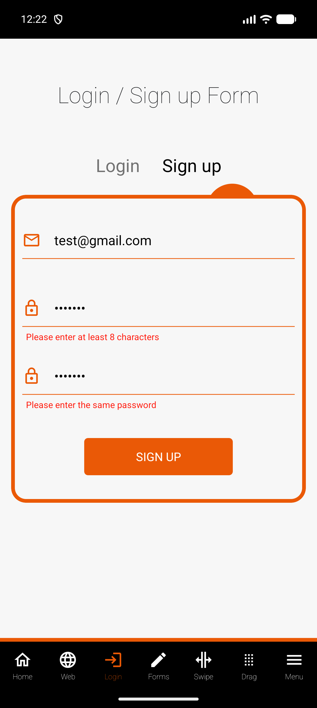

# Bugs found

## BUG-01: Sign up shows "Please enter the same password" although both passwords match

- **Severity:** Low to medium. The message is misleading, but nothing is lost and the user can still fix the form.
- **Environment:** WebdriverIO Native Demo App v2.2.0, Android 17 emulator (sdk_gphone64_arm64).
- **Reproducible:** Yes, every time (seen in manual probing and again when taking the screenshot).

**Steps**
1. Open the app and go to the Login tab, then switch to Sign up.
2. Enter email `test@gmail.com`.
3. Enter `1234567` (7 characters) in Password and `1234567` in Confirm password.
4. Tap SIGN UP.

**Expected:** only "Please enter at least 8 characters" under Password. The two passwords are identical, so there should be no error under Confirm password.

**Actual:** "Please enter at least 8 characters" under Password, plus "Please enter the same password" under Confirm password, even though both fields match.

**Evidence:** 

**Impact:** a user who only needs to lengthen the password is told the fields don't match, so they may retype the confirm field for no reason.

**Test coverage:** not automated on purpose. A test for this case would either fail today or lock in the wrong behaviour. See SU-04 in [docs/test-cases.md](docs/test-cases.md).
